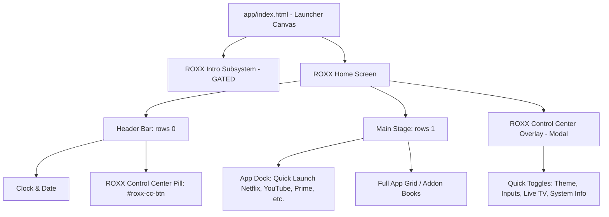
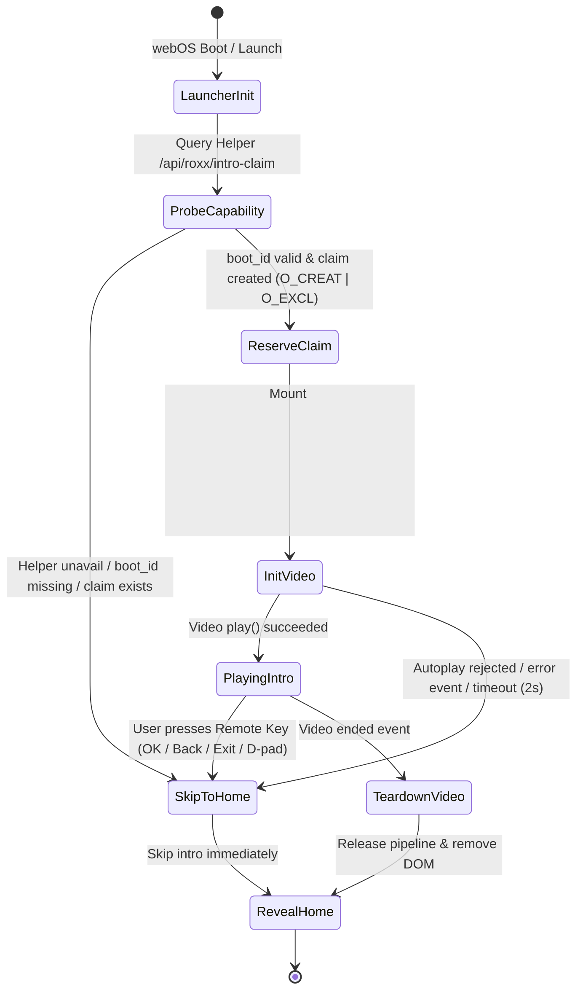

# ROXX Avengers Edition — Master Architecture & Implementation Specification
**Brand**: STARK INDUSTRIES × ROXX  
**System Base**: CleanYourTV webOS Launcher  
**Target Television**: LG 43UR7550PSC (webOS 25, Software 10.3.2-33)  
**Document Revision**: 2.0 (Phase 2 Architecture Specification)

---

## 1. Product Vision & Design System

ROXX Avengers Edition transforms the CleanYourTV webOS launcher into a lightweight, television-first smart interface inspired by Stark Industries tactical telemetry. The design emphasizes speed, high contrast, clean typography, and zero background bloat.

### 1.1 Color Tokens & Material Surfaces
```css
/* Primitive & Semantic Palette */
--roxx-bg-night:       #08090B; /* Deep matte black background (OLED-friendly) */
--roxx-surface-panel:  #12151B; /* Dark charcoal card and menu surface */
--roxx-surface-elev:   #1A1E26; /* Elevated active surface */
--roxx-ink-primary:    #F5F6F8; /* Clean off-white primary text */
--roxx-ink-secondary:  #8E95A5; /* Muted slate sub-labels and metadata */
--roxx-accent-stark:   #D12727; /* Restrained Stark red focus / highlight */
--roxx-accent-gold:    #D4AF37; /* Muted secondary metallic gold */
--roxx-ring-focus:     #D12727; /* High-visibility remote focus ring */
--roxx-border-subtle:  rgba(255, 255, 255, 0.08);
```

### 1.2 Typography & 10-Foot UI Scale
- **Display Typeface**: System sans-serif optimized for TV viewing (`system-ui, -apple-system, sans-serif`).
- **Clock**: Large numeric display, tabular numerals (`font-variant-numeric: tabular-nums`).
- **Legibility Rules**:
  - Minimum body text: 18px (at 1080p canvas scaled to 4K).
  - High typographic contrast (WCAG AAA for clock and primary app labels).
  - No low-contrast grey on grey; no unbordered red text on black.

---

## 2. Component Architecture



### 2.1 Header Bar Integration (`rows[0]`)
- Integrated into CleanYourTV's existing header structure (`app/src/js/layout.js`, `menus.js`).
- Contains the readable time and date, network status, and the **ROXX Control Center** pill button (`#roxx-cc-btn`).
- Clean, non-intrusive Stark telemetry styling with pill radius `24px`.

### 2.2 ROXX Control Center Overlay (`#roxx-cc-overlay`)
- A lightweight, remote-first overlay presenting essential controls without leaving the launcher:
  - Theme Selection (ROXX Avengers, OLED Black, Classic, etc.).
  - Input Switcher shortcut (opens Inputs picker).
  - Live TV quick toggle (opens IPTV addon).
  - System Telemetry (webOS version, uptime, storage status, IP address masked).
- Modal navigation: Traps D-pad focus within the overlay when open; **Back** key (`461`, `27`, `8`) instantly dismisses and restores focus to `#roxx-cc-btn`.

### 2.3 Minimal App Dock
- Centered dock row holding user's primary apps (Netflix, YouTube, Prime Video, Disney+).
- Spaces tiles with standard margins (no CSS `gap` property, preserving Chromium 68 compatibility on webOS 5/6).
- Preserves CleanYourTV tile focus ring with rounded corners (`.tile.f::before`).

---

## 3. Remote Navigation & Focus Map

```
                     [ Header Bar: rows[0] ]
                  ┌───────────────────────────┐
                  │ Clock   [ROXX Telemetry]  │
                  └──────────────▲────────────┘
                                 │ Arrow Up
                                 │ Arrow Down
                  ┌──────────────▼────────────┐
                  │       App Dock: rows[1]   │
                  │ [App 1] [App 2] [App 3]   │
                  └──────────────▲────────────┘
                                 │ Arrow Down
                                 │ Arrow Up
                  ┌──────────────▼────────────┐
                  │       App Grid: rows[2]   │
                  └───────────────────────────┘
```

### Key Handling Specification
- **Arrow Up (from Dock)**: Moves focus up to `#roxx-cc-btn` in `rows[0]`.
- **Arrow Down (from Header)**: Returns focus to previously focused Dock tile in `rows[1]`.
- **OK (Keycode 13)** on `#roxx-cc-btn`: Opens ROXX Control Center overlay; sets focus to first overlay option.
- **Back (Keycode 461 / 27 / 8)**:
  - If Control Center is open: Closes overlay, returns focus to `#roxx-cc-btn`.
  - If Home is focused: Triggers CleanYourTV running apps list or default back action.
- **Color Keys**: Blue key (`406`) is NOT bound directly to Control Center because it is claimed by CleanYourTV multi-page add-on books (`PAGER.pageKey`). Header pill activation ensures 100% collision-free navigation.

---

## 4. Cold-Boot Intro Subsystem (Gated Architecture)

### 4.1 Asset Specifications
- **Local File**: `C:\Users\sujal\Downloads\YTDown.com_YouTube_Media_Ynm6Vgyzah4_Marvel-Intro-HD_002_720p.mp4`
- **Video Stream**: H.264 / AVC Main Profile, Level 3.1, 1280×720, 25 fps.
- **Audio Stream**: AAC-LC stereo, 44.1 kHz, 128 kbps.
- **Security Rule**: The MP4 video file is strictly local, added to `.gitignore`, and NEVER committed to Git or pushed to any public repository.

### 4.2 State Machine & Execution Flow



### 4.3 Media Pipeline Release & Memory Safety
To ensure zero leak of the hardware media decoding pipeline on LG webOS:
1. `video.pause()`
2. `video.removeAttribute('src')`
3. `video.load()` (forces Chromium / webOS media pipeline release)
4. Remove `#roxx-intro-container` from document DOM.
5. Nullify all JS references to garbage-collect media handlers.

---

## 5. Error Handling & Fail-Safe Matrix

| Event / Failure Mode | Fallback Response | Verification Metric |
|---|---|---|
| Helper service unreachable (HTTP 5xx / timeout) | Bypass intro; immediately display Home screen | `0ms` delay to user |
| `/proc/sys/kernel/random/boot_id` unreadable | Skip intro; open Home | No crash, logged error |
| State directory read-only (`EACCES` / `EROFS`) | Skip intro; open Home | Safe degradation |
| Video file not found on TV disk | Skip intro; open Home | Handled in `video.onerror` |
| Autoplay with sound rejected by browser policy | Attempt unmuted playback with onscreen un-mute pill, or skip | No silent hang |
| Remote key pressed during intro | Instantly tear down video and transition to Home | `<50ms` latency |
| Standby / Quick Start+ wake | Boot ID unchanged -> claim persists -> Intro skipped | Clean wake directly to Home |

---

## 6. Performance Budgets

| Metric | Budget Target | Desktop Measured | TV Physical Status |
|---|---|---|---|
| Static DOM Node Count | < 250 elements | 150 elements | VERIFIED on build artifact |
| Home Initial Render Time | < 500 ms | ~313 ms build time | **NOT TESTED** on physical TV |
| Intro Skip Latency | < 100 ms | < 16 ms in simulation | **NOT TESTED** on physical TV |
| Helper Service Memory (RSS) | < 35 MB on TV | 62 MB (Node 22 Win11) | **NOT TESTED** on 32-bit ARM |
| Launcher Idle CPU Usage | 0% | 0% | VERIFIED (no persistent timers) |

---

## 7. Rollback & Recovery Architecture

CleanYourTV and ROXX operate entirely in userland RAM mounts (`tmpfs` / `/media/developer/`).
1. **Soft Rollback**: Settings -> Update channel / Theme -> revert to `Classic` or `OLED Black`.
2. **Boot Rollback**: Manager app -> "CleanYourTV as Home" OFF, or execute `sh /media/developer/cleanyourtv/undo-home.sh`.
3. **Hard Emergency Recovery**: Reboot TV with Homebrew Channel failsafe (pressing remote channel buttons during boot) to bypass boot scripts, restoring stock LG Home immediately.
